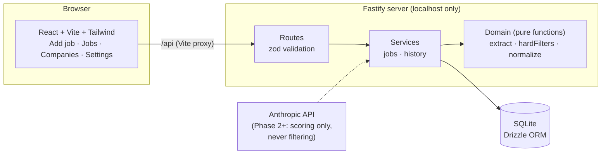

# Job Search Autopilot

A personal app that runs my job search: it finds and checks postings, prepares applications, and keeps me in the loop. **Nothing is submitted without my explicit approval, one application at a time.**

I'm a software engineer on STEM OPT, which narrows down which jobs I can take: the employer has to be enrolled in E-Verify, the job has to be W-2 and at least 20 hours a week, the role has to relate to my degree, and so on. Checking each posting against those rules by hand is slow and easy to get wrong. This app checks them in code and shows me the exact line of the posting behind each verdict.

## Status

| Phase | What it adds | Status |
|---|---|---|
| 1. Foundations | Schema, settings, company list, paste a job → deterministic hard filters | ✅ Done |
| 2. Scoring + shortlist | LLM fit scoring, tiers, Greenhouse/Lever/Ashby fetchers, daily cron | Next |
| 3. Prep + Truth Check | Tailored resumes, a code-level check that blocks any unverified claim, review queue | |
| 4. Assisted submit | Playwright prefills the form; I review and click submit myself | |
| 5. Dashboard + mentor | Progress vs targets, daily check-ins, time and API-cost tracking | |
| 6. Polish | Demo, measured results | |

## What Phase 1 does

1. **Paste a posting** from anywhere, including LinkedIn. The app never scrapes LinkedIn or opens the link.
2. **Read it.** Regexes pull out years of experience, sponsorship language, remote/location, employment type (1099, C2C, contract, staffing agency, part-time), and clearance or citizenship requirements. Each field comes with the snippet it was read from.
3. **Correct it.** You review the fields and fix anything the regex got wrong. The verdict updates live as you edit.
4. **Filter.** Deterministic hard filters run on the reviewed fields. Every failing rule is listed, not just the first, along with its evidence.
5. **Store.** The job is saved with its verdict. Duplicates (same company, title, and location) return the existing job instead of a second copy.

Confirming a company's E-Verify status re-checks every job at that company.

## Architecture



The rule that shapes the layout: **anything that decides eligibility is a pure function** in `server/src/domain/`, with no database, network, clock, or LLM inside it. That keeps it unit-testable and keeps the same input producing the same answer. The LLM arrives in Phase 2, and only for fit scoring.

```
server/
  src/domain/     extract.ts, hardFilters.ts, normalize.ts   ← the rules, pure
  src/services/   jobs.ts (dedupe → filter → store), history.ts (30-day window)
  src/routes/     HTTP + zod validation
  src/db/         schema.ts, migrations, idempotent seed
  test/           Vitest: rules, edge cases, API acceptance test
web/src/          pages/, components/ (FieldsEditor, Verdict, Evidence)
shared/types.ts   types used by both sides
data/             companies.seed.csv; private/ is gitignored
```

## Setup

Requirements: Node 22+.

```bash
git clone https://github.com/minahilnkhan/job-search-autopilot.git
cd job-search-autopilot
npm install
cp .env.example .env      # nothing is required for Phase 1
npm run dev               # migrates + seeds on boot; API on :3001, app on :5173
```

Open http://localhost:5173.

Other commands:

```bash
npm test             # Vitest (server)
npm run typecheck    # both workspaces
npm run setup        # migrate + seed without starting the server
```

The SQLite file lives at `data/autopilot.db`, which is gitignored. To start over, delete it and restart.

## Design decisions

The short version is below. [`docs/decisions.md`](docs/decisions.md) has the reasoning and the alternatives considered.

- **Regex prefill, human confirms, code decides.** Extraction is allowed to be wrong because you review it. The filters only see confirmed fields.
- **Hard filters are deterministic code, not an LLM call.** Eligibility rules have to be explainable and testable, and the same posting must always get the same answer.
- **Every rule runs, every time.** No short-circuit, so you see every reason a job fails.
- **Evidence everywhere.** Each verdict carries the posting text that triggered it.
- **EEO boilerplate is stripped before matching.** "Without regard to … citizenship" is not a citizenship requirement. Sentence splitting also doesn't break on "U.S.".
- **Work-authorization answers are fixed settings,** never generated.
- **Secrets only in `.env`; personal data only in `data/private/`.** Both are gitignored.

## Known limitations (Phase 1)

- Extraction is English-only regex. It catches common phrasings, not all of them, which is why every field is editable.
- Location rules use a keyword list. A city with the same name as a foreign one (like Paris, TX) can be misread as non-US; correct it in the location field.
- E-Verify has no public API, so you confirm each company by hand. The app links to the official search.
- The seed company ATS board tokens are unverified until Phase 2 checks each endpoint.
- `npm audit` reports 4 moderate advisories in `drizzle-kit`'s bundled esbuild. That's a dev-only CLI used to generate migrations; it doesn't ship and runs no dev server.
