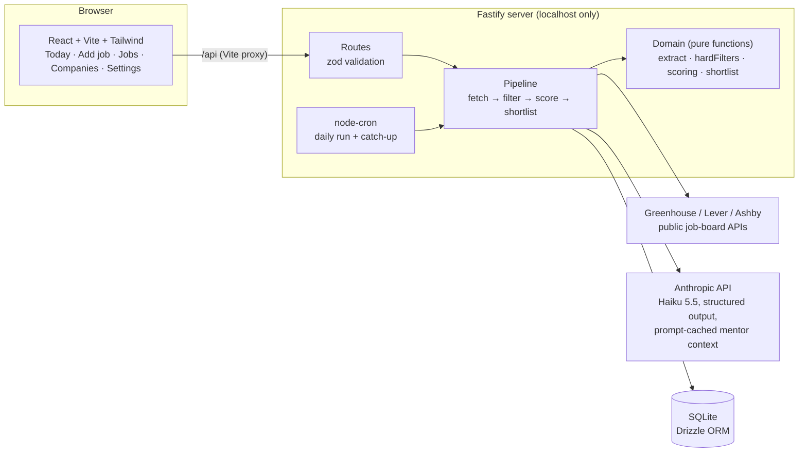

# Job Search Autopilot

A personal app that runs my job search: it finds and checks postings, prepares applications, and keeps me in the loop. **Nothing is submitted without my explicit approval, one application at a time.**

I'm a software engineer on STEM OPT, which narrows down which jobs I can take: the employer has to be enrolled in E-Verify, the job has to be W-2 and at least 20 hours a week, the role has to relate to my degree, and so on. Checking each posting against those rules by hand is slow and easy to get wrong. This app checks them in code and shows me the exact line of the posting behind each verdict.

## Status

| Phase | What it adds | Status |
|---|---|---|
| 1. Foundations | Schema, settings, company list, paste a job → deterministic hard filters | ✅ Done |
| 2. Scoring + shortlist | Greenhouse/Lever/Ashby fetchers, AI fit scoring, tiers, daily ranked shortlist, schedule | ✅ Done |
| 3. Prep + Truth Check | Tailored resumes, a code-level check that blocks any unverified claim, review queue | Next |
| 4. Assisted submit | Playwright prefills the form; I review and click submit myself | |
| 5. Dashboard + mentor | Progress vs targets, daily check-ins, time and API-cost tracking | |
| 6. Polish | Demo, measured results | |

## What Phase 1 does

1. **Paste a posting** from anywhere, including LinkedIn. The app never scrapes LinkedIn or opens the link.
2. **Read it.** Regexes pull out years of experience, sponsorship language, remote/location, employment type (1099, C2C, contract, staffing agency, part-time), and clearance or citizenship requirements. Each field comes with the snippet it was read from.
3. **Correct it.** You review the fields and fix anything the regex got wrong. The verdict updates live as you edit.
4. **Filter.** Deterministic hard filters run on the reviewed fields. Every failing rule is listed, not just the first, along with its evidence.
5. **Store.** The job is saved with its verdict. Duplicates (same company, title, and location) return the existing job instead of a second copy.

Confirming a company's E-Verify status re-checks every job at that company.

## What Phase 2 adds

Every morning (7:00 Chicago by default, or **Run now**):

1. **Fetch** every open posting from each company's public Greenhouse, Lever or Ashby job-board API.
2. **Dedupe and filter** with the same Phase 1 rules. Job-board postings also have to match your target roles (FDE, solutions, deployment, implementation, applied AI, new-grad or full-stack/backend SWE), and postings older than 30 days aren't scored. On a first run, about 1,100 postings came down to roughly 300 before any AI call.
3. **Score** what passes with Claude Haiku 5.5 against the mentor prompt's 1–10 rubric. The model judges each must-have requirement (met / partly / not, with the inventory fact as evidence), role signal, and stack match. Code does the arithmetic: requirements share → 0–4, strategic bonus from company facts, tiers, the "no sponsorship → Tier B" cap, and stale-posting flags.
4. **Shortlist**: the daily target plus three spares, ranked by score, freshness, then Chicago/remote, with at most two per company in 30 days. You accept or dismiss each one; nothing is applied to automatically.

Every AI call is logged with its token counts and cost. The mentor prompt and inventory are prompt-cached, so a scored job costs about $0.001.

## Architecture



The rule that shapes the layout: **anything that decides eligibility, or does arithmetic on a score, is a pure function** in `server/src/domain/`, with no database, network, clock, or LLM inside it. That keeps it unit-testable and keeps the same input producing the same answer. The LLM only supplies judgments (is this requirement met, how strong is the role signal); it never filters and never totals.

```
server/
  src/domain/     extract, hardFilters, roleFamily, scoring, shortlist   ← the rules, pure
  src/sources/    Greenhouse / Lever / Ashby fetchers → one posting shape
  src/llm/        scoring prompt + JSON schema, pricing, mentor-context loader
  src/services/   jobs, history (30-day window), pipeline, usage (cost log)
  src/scheduler.ts  daily cron + catch-up after sleep
  src/routes/     HTTP + zod validation
  src/db/         schema.ts, migrations, idempotent seed
  test/           Vitest: rules, edge cases, API acceptance test
web/src/          pages/, components/ (FieldsEditor, Verdict, Evidence)
shared/types.ts   types used by both sides
data/             companies.seed.csv; private/ is gitignored
```

## Setup

Requirements: Node 22+.

```bash
git clone https://github.com/minahilnkhan/job-search-autopilot.git
cd job-search-autopilot
npm install
cp .env.example .env      # add ANTHROPIC_API_KEY for scoring
npm run dev               # migrates + seeds on boot; API on :3001, app on :5173
```

Open http://localhost:5173.

**For scoring (Phase 2+)**, put two personal files in `data/private/` (gitignored):

- `job-mentor-prompt.md`: the mentor agent's system prompt (rubric, filters, tiers)
- `candidate_inventory.md`: verified facts plus the DO NOT CLAIM list (see `candidate_inventory.example.md`)

Without the key or these files, runs still fetch and filter, and the run message says what's missing.

Other commands:

```bash
npm test             # Vitest (server)
npm run typecheck    # both workspaces
npm run setup        # migrate + seed without starting the server
npm run pipeline     # one run from the terminal (use Run now instead while the app is open)
npm run db:studio    # browse the SQLite database in Drizzle Studio
```

The SQLite file lives at `data/autopilot.db`, which is gitignored. To start over, delete it and restart.

## Design decisions

The short version is below. [`docs/decisions.md`](docs/decisions.md) has the reasoning and the alternatives considered.

- **Regex prefill, human confirms, code decides.** Extraction is allowed to be wrong because you review it. The filters only see confirmed fields.
- **Hard filters are deterministic code, not an LLM call.** Eligibility rules have to be explainable and testable, and the same posting must always get the same answer.
- **Every rule runs, every time.** No short-circuit, so you see every reason a job fails.
- **Evidence everywhere.** Each verdict carries the posting text that triggered it.
- **EEO boilerplate is stripped before matching.** "Without regard to … citizenship" is not a citizenship requirement. Sentence splitting also doesn't break on "U.S.".
- **Work-authorization answers are fixed settings,** never generated.
- **Secrets only in `.env`; personal data only in `data/private/`.** Both are gitignored.

## Known limitations

Phase 2:
- The schedule fires only while the app is running. If your laptop is asleep at run time, the next start catches up.
- Postings from job boards skip the human review step, so their filter verdicts come straight from regex extraction. **Correct fields** on the Jobs page re-checks them.
- The scoring cap (150 per run by default) can leave a backlog after the very first run; the next run picks it up.
- Only Greenhouse, Lever and Ashby. Hacker News "Who's Hiring" and the DOL H-1B import are later additions; until then H-1B history is entered by hand on a company.
- Tests run against saved job-board responses and a fake scorer; the first live run happens on your machine.

Phase 1:

- Extraction is English-only regex. It catches common phrasings, not all of them, which is why every field is editable.
- Location rules use a keyword list. A city with the same name as a foreign one (like Paris, TX) can be misread as non-US; correct it in the location field.
- E-Verify has no public API, so you confirm each company by hand. The app links to the official search.
- `npm audit` reports 4 moderate advisories in `drizzle-kit`'s bundled esbuild. That's a dev-only CLI used to generate migrations; it doesn't ship and runs no dev server.
