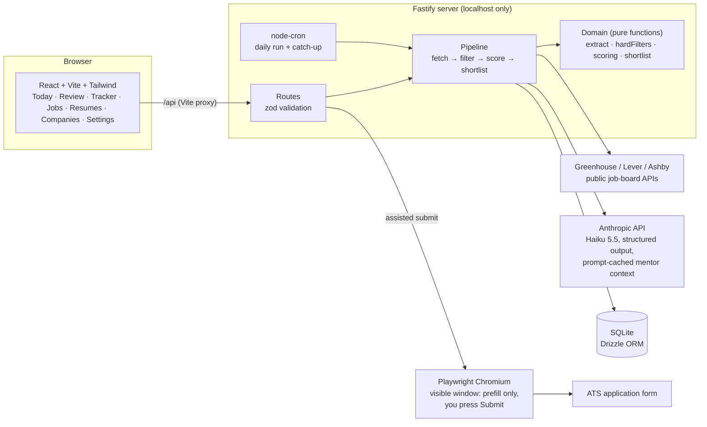

# Job Search Autopilot

A personal app that runs my job search: it finds and checks postings, prepares applications, and keeps me in the loop. **Nothing is submitted without my explicit approval, one application at a time.**

I'm a software engineer on STEM OPT, which narrows down which jobs I can take: the employer has to be enrolled in E-Verify, the job has to be W-2 and at least 20 hours a week, the role has to relate to my degree, and so on. Checking each posting against those rules by hand is slow and easy to get wrong. This app checks them in code and shows me the exact line of the posting behind each verdict.

## Status

| Phase | What it adds | Status |
|---|---|---|
| 1. Foundations | Schema, settings, company list, paste a job → deterministic hard filters | ✅ Done |
| 2. Scoring + shortlist | Greenhouse/Lever/Ashby fetchers, AI fit scoring, tiers, daily ranked shortlist, schedule | ✅ Done |
| 3. Prep + Truth Check | Tailored resumes, a code-level check that blocks any unverified claim, review queue | ✅ Done |
| 4. Assisted submit | Playwright prefills the form; I review and click submit myself | Next |
| 5. Dashboard + mentor | Progress vs targets, daily check-ins, time and API-cost tracking | |
| 6. Polish | Demo, measured results | |

## What Phase 1 does

1. **Paste a posting** from anywhere, including LinkedIn. The app never scrapes LinkedIn or opens the link.
2. **Read it.** Regexes pull out years of experience, sponsorship language, remote/location, employment type (1099, C2C, contract, staffing agency, part-time), and clearance or citizenship requirements. Each field comes with the snippet it was read from.
3. **Correct it.** You review the fields and fix anything the regex got wrong. The verdict updates live as you edit.
4. **Filter.** Deterministic hard filters run on the reviewed fields. Every failing rule is listed, not just the first, along with its evidence.
5. **Store.** The job is saved with its verdict. Duplicates (same company, title, and location) return the existing job instead of a second copy.

Confirming a company's E-Verify status re-checks every job at that company.

## What Phase 2 adds

Every morning (7:00 Chicago by default, or **Run now**):

1. **Fetch** every open posting from each company's public Greenhouse, Lever or Ashby job-board API.
2. **Dedupe and filter** with the same Phase 1 rules. Job-board postings also have to match your target roles (FDE, solutions, deployment, implementation, applied AI, new-grad or full-stack/backend SWE), and postings older than 30 days aren't scored. On a first run, about 1,100 postings came down to roughly 300 before any AI call.
3. **Score** what passes with Claude Haiku 5.5 against the mentor prompt's 1–10 rubric. The model judges each must-have requirement (met / partly / not, with the inventory fact as evidence), role signal, and stack match. Code does the arithmetic: requirements share → 0–4, strategic bonus from company facts, tiers, the "no sponsorship → Tier B" cap, and stale-posting flags.
4. **Today's deck**: 5 Tier A and 5 Tier B jobs (set in Settings), Tier A first, ranked by score (+1 for Chicago within a tier), freshness, then remote, with at most two per company in 30 days. One card at a time: swipe right (or →) to accept, left (or ←) to skip, with Undo for a skip. Each decision tops the deck back up from the next-ranked jobs, so **Check for new postings** (the old Run now) is only for new postings. Nothing is applied to automatically.

Every AI call is logged with its token counts and cost. The mentor prompt and inventory are prompt-cached, so a scored job costs about $0.001.

## What Phase 3 adds

**Accept and prepare** on a job builds the application:

- **Tier A:** Claude Sonnet 5.5 tailors the matching base resume (FDE or SWE) following [docs/tailoring.md](docs/tailoring.md): pull the posting's keywords and must-haves, match them against the resume and the inventory, rewrite and reorder bullets so matches come first, add up to three truthful sentences for keywords the inventory supports, drop weaker bullets to stay on one page, and write a summary under 50 words that starts with the posting's role noun. It can't add employers, titles, dates or numbers that aren't in the inventory. Swaps it can't make (e.g. bringing in the TA role) show up as suggestions in Review.
- **Tier B:** the base resume as-is, plus your standard answers. No model call: Tier B costs nothing to prepare.
- **Accept returns right away.** Preparation runs in the background; the application appears in Review (under Needs fixes if the Truth Check flags something). A base resume with Truth Check problems has to be fixed on the Resumes page first.
- **Fix where it's flagged:** every Truth Check problem in Review has its own edit box (resume line, contact line or answer). "Rebuild from base resume" restarts an application after you fix the base.
- **Work-authorization answers** always come from Settings and can't be edited per application.

Then the **Truth Check** runs in code over every resume line and every answer:

| Check | Example it blocks |
|---|---|
| Every number must appear in `candidate_inventory.md` (50K = 50,000; ~ and + ignored) | "used by 12 teams" when 12 isn't in the inventory |
| Nothing on the DO NOT CLAIM list, which is parsed from the inventory into `do_not_claim.json` | "Cut latency 60%" |
| No ownership verbs (designed, built, architected…) on work the inventory says someone else designed | "Designed the caching layer" |
| No unfilled `[placeholders]` | "[email]" |
| Banned style words (warning only) | "leveraged" |

Any failure keeps the application out of the review queue, showing the exact line, where it is and why, until you fix it or override it with a written reason. Any later edit clears the override. A PDF that's missing or longer than one page always blocks approval.

The **resume** is one structure rendered two ways: Chromium prints the HTML template to PDF (page count checked with pdf-lib), and the `docx` library writes the matching DOCX. They can't drift apart.

The **Review** page shows the job, its score and gaps, each resume change as before → after, a PDF preview and the answers, all editable inline. Actions: **Approve** (one application at a time), **Not applying** (with a reason, kept for tuning scoring), **Snooze**.

## How a day works

The app is four places: **Today**, **Applications**, **Jobs** and **Settings** (with Resumes and Companies inside it). Today is a four-step checklist:

1. **Pick today's jobs**: a deck of Tier A then Tier B picks. Swipe or use ← → to accept or skip.
2. **Review and approve**: one application at a time, with ‹ › to the next. What changed in the resume, and the Truth Check result up front; answers and the score folded away.
3. **Submit**: open each approved application in Chrome and press **Fill** in the extension.
4. **Follow up**: Tier A applications a week after submitting, with **Draft a follow-up**.

**Applications** merges the review queue and the tracker: To review, Needs a fix, Ready to submit, Submitted, Interviewing, Closed.

## Filling forms in your own Chrome

The recommended way to apply is the **Chrome extension** in [`extension/`](extension/README.md). You open the job in your normal Chrome, click the extension, and press **Fill this form**. It pulls the approved application from the app (contact details, resume PDF, prepared and drafted answers) and fills the page using the same matching rules as below. It asks you in its side panel about anything only you can answer, and records the submission when you press **I submitted it**. Its **Chat** tab takes requests like "shorten Why Anthropic to two sentences": it proposes edits to resume lines, answers or the note, the Truth Check filters them, and **Apply** updates the application and the open form (and re-attaches the resume if it changed). An approved application stays approved only if it still passes and fits on one page. Because it's your real browser, sites that block automated browsers (like Ashby) work normally. It only acts when you press Fill, and it never submits.

The extension proves it's yours with a pairing code from Settings. The server also refuses requests addressed to any host other than localhost, so a web page can't use DNS tricks to read your data.

## What Phase 4 adds

**Assisted submit.** On an approved application, **Open and prefill** opens the real application form in a visible Chromium window on your machine and fills in what it can:

- Name, email, phone, location, LinkedIn/GitHub and current company, from **Settings → Profile**.
- Your resume PDF, uploaded under a proper file name.
- Work-authorization questions, always with the fixed answers from Settings.
- Any question that closely matches one of the application's prepared answers. Optional "cover letter / additional information" boxes stay empty.

Questions nothing prepared covers ("Why Anthropic?", "Tell us about a project") are drafted on the spot by Claude Sonnet from your inventory and the posting, Truth-Checked, and typed in. When an answer depends on something only you know (salary, start date, a referral) or a draft fails the Truth Check, the app asks you in a **Questions for you** chat on that application; your reply goes straight into the open form, and you can keep it for every application.

You review the form and press **Submit** yourself. The app never submits and never touches a CAPTCHA (the only button it may press is a resume "Attach" button, to open the file picker). It watches for the "thank you for applying" page and marks the application **submitted**; **I submitted it** does the same by hand. A panel lists what was filled and what's left for you, and a **copy panel** has every value with a copy button, which is also the fallback when a form can't be read.

Fields are found by their visible labels (plus id/name hints), so the same rules cover Greenhouse, Lever, Ashby and most hand-built forms. Voluntary demographic questions, consent checkboxes and anything without a confident match are left for you.

**Sites that block automated browsers** (Ashby flags the app's window as spam) go through **copy mode**: the app reads the form in a hidden window, never filling or submitting, prepares every answer in the form's order with a copy button each, and you apply in your own browser. If any other site shows a spam block, the app says so and adds that site to the list in Settings.

The **Tracker** page lists submitted applications. Move each through screen → interview → offer, or rejected / ghosted / withdrawn. Tier A applications get a follow-up date 7 days after submitting.

## Architecture



The rule that shapes the layout: **anything that decides eligibility, or does arithmetic on a score, is a pure function** in `server/src/domain/`, with no database, network, clock, or LLM inside it. That keeps it unit-testable and keeps the same input producing the same answer. The LLM only supplies judgments (is this requirement met, how strong is the role signal); it never filters and never totals.

```
server/
  src/domain/     extract, hardFilters, roleFamily, scoring, shortlist,
                  inventory, truthCheck, resumeFormat, tailorPlan,
                  applicationStatus                         ← the rules, pure
  src/sources/    Greenhouse / Lever / Ashby fetchers → one posting shape
  src/llm/        scoring + tailoring prompts and JSON schemas, pricing, mentor-context loader
  src/render/     resume HTML template → PDF (Chromium), DOCX (docx)
  src/submit/     applyUrl, plan (which value goes in which field; pure), confirm,
                  prefill (reads and fills the form in the browser), browser
  src/services/   jobs, history (30-day window), pipeline, usage (cost log),
                  resumes, applications (prep + review), truth, submissions
  src/scheduler.ts  daily cron + catch-up after sleep
  src/routes/     HTTP + zod validation
  src/db/         schema.ts, migrations, idempotent seed
  test/           Vitest: rules, edge cases, API acceptance test
web/src/          pages/, components/ (FieldsEditor, Verdict, Evidence)
shared/types.ts   types used by both sides
data/             companies.seed.csv; private/ is gitignored
```

## Setup

Requirements: Node 22+.

```bash
git clone https://github.com/minahilnkhan/job-search-autopilot.git
cd job-search-autopilot
npm install
cp .env.example .env      # add ANTHROPIC_API_KEY for scoring
npm run dev               # migrates + seeds on boot; API on :3001, app on :5173
```

Open http://localhost:5173.

**For scoring (Phase 2+)**, put two personal files in `data/private/` (gitignored):

- `job-mentor-prompt.md`: the mentor agent's system prompt. Shared rules plus `# MODULE:` sections; each call gets only the module it needs
- `confirmed_additions.md`: written by the app when you confirm an assumption question; read as part of your inventory (edit or delete lines freely)
- `candidate_inventory.md`: verified facts plus the DO NOT CLAIM list (see `candidate_inventory.example.md`)

Without the key or these files, runs still fetch and filter, and the run message says what's missing.

**For resumes (Phase 3+)**, one-time:

```bash
npm run setup:pdf   # downloads the Chromium build used to print resume PDFs
```

Then put your base resumes in `data/private/resume_fde.md` and `resume_swe.md` (imported on first start), or paste them on the **Resumes** page.

Other commands:

```bash
npm test             # Vitest (server)
npm run typecheck    # both workspaces
npm run setup        # migrate + seed without starting the server
npm run pipeline     # one run from the terminal (use Run now instead while the app is open)
npm run db:studio    # browse the SQLite database in Drizzle Studio
```

The SQLite file lives at `data/autopilot.db`, which is gitignored. To start over, delete it and restart.

## Design decisions

The short version is below. [`docs/decisions.md`](docs/decisions.md) has the reasoning and the alternatives considered.

- **Regex prefill, human confirms, code decides.** Extraction is allowed to be wrong because you review it. The filters only see confirmed fields.
- **Hard filters are deterministic code, not an LLM call.** Eligibility rules have to be explainable and testable, and the same posting must always get the same answer.
- **Every rule runs, every time.** No short-circuit, so you see every reason a job fails.
- **Evidence everywhere.** Each verdict carries the posting text that triggered it.
- **EEO boilerplate is stripped before matching.** "Without regard to … citizenship" is not a citizenship requirement. Sentence splitting also doesn't break on "U.S.".
- **Work-authorization answers are fixed settings,** never generated.
- **Secrets only in `.env`; personal data only in `data/private/`.** Both are gitignored.

## Known limitations

Phase 3:
- The Truth Check verifies numbers, listed false claims and ownership words. It can't judge every qualitative overstatement ("the same loop as customer feedback"), which is why every changed line is shown before → after for your review.
- The DOCX mirrors the PDF's layout, but Word can wrap slightly differently. The one-page check runs on the PDF.
- Phrases are matched literally, so a reworded DO NOT CLAIM item without its number can slip through. Add sharper patterns in `do_not_claim.extra.json`.

Phase 2:
- The schedule fires only while the app is running. If your laptop is asleep at run time, the next start catches up.
- Postings from job boards skip the human review step, so their filter verdicts come straight from regex extraction. **Correct fields** on the Jobs page re-checks them.
- The scoring cap (150 per run by default) can leave a backlog after the very first run; the next run picks it up.
- Only Greenhouse, Lever and Ashby. Hacker News "Who's Hiring" and the DOL H-1B import are later additions; until then H-1B history is entered by hand on a company.
- Tests run against saved job-board responses and a fake scorer; the first live run happens on your machine.

Phase 1:

- Extraction is English-only regex. It catches common phrasings, not all of them, which is why every field is editable.
- Location rules use a keyword list. A city with the same name as a foreign one (like Paris, TX) can be misread as non-US; correct it in the location field.
- E-Verify has no public API, so you confirm each company by hand. The app links to the official search.
- `npm audit` reports 4 moderate advisories in `drizzle-kit`'s bundled esbuild. That's a dev-only CLI used to generate migrations; it doesn't ship and runs no dev server.
